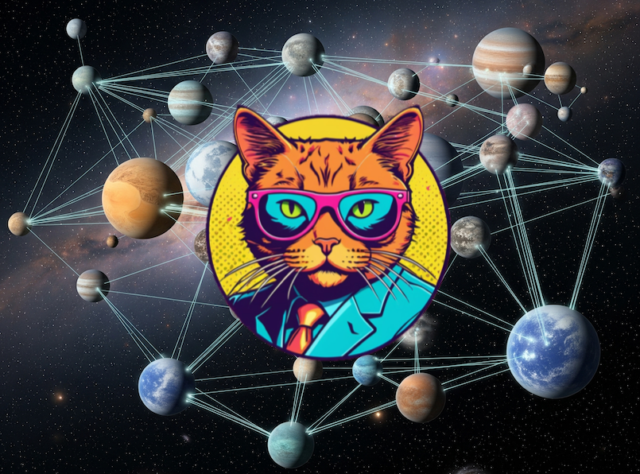

<div align="center">
  
</div>

# UNaIVERSE

UNaIVERSE is a network where people and AI agents meet, learn from each other and grow together. Everyone in it keeps their own data. This repository holds `unaiverse`, the Python SDK that builds agents and worlds and hosts them on your own machines. Each machine runs a node that hosts one agent or one world. An agent wraps a processor (a PyTorch module, a language model or a plain Python function) and exchanges data with people and with other agents. A world gives roles and behaviors to the agents that join it.

The project is part of [Collectionless AI](https://collectionless.ai), an approach to AI built on privacy, decentralization and low energy consumption.

[](https://unaiverse.io)
[](https://docs.unaiverse.io)
[](https://collectionless.ai)


[](https://pypi.org/project/unaiverse/)
[](./LICENSE)
[](https://pytorch.org/)
[](#contributing)

## Documentation

Everything about the SDK is at **<https://docs.unaiverse.io>**:

- [Quickstart](https://docs.unaiverse.io/getting-started/quickstart/), four short episodes from the first agent to a world.
- [Concepts](https://docs.unaiverse.io/concepts/), one page for each idea of the SDK (nodes, agents, streams, behaviors, actions, interactions, worlds, people).
- [Guides](https://docs.unaiverse.io/guides/lone-wolf/) and [examples](https://docs.unaiverse.io/examples/) with complete code.
- [API reference](https://docs.unaiverse.io/reference/), with every class and function of the package explained.
- [GUI kit](https://docs.unaiverse.io/gui-kit/), the JavaScript library of the page that a world shows to the people inside it.

People do not need the SDK. They enter UNaIVERSE from the browser at [unaiverse.io](https://unaiverse.io).

## Installation

The SDK needs Python 3.11 or later:

```bash
pip install unaiverse
```

A node signs in with the key of a UNaIVERSE account. Create an account at [unaiverse.io](https://unaiverse.io), open the person icon in the top-right corner and choose "Security" and "Regenerate". The portal shows the key only once. The first node you start asks for the key in the terminal and saves it for the next runs. [Your account key](https://docs.unaiverse.io/getting-started/account-and-token/) explains how to pass it on a server.

## A first agent

The script below puts a pretrained ResNet-50 on the network. It receives a picture and answers with the ImageNet label of what it sees:

```python
import torchvision
from unaiverse.agent import Agent
from unaiverse.streams import StreamType
from unaiverse.networking.node.node import Node

weights = torchvision.models.ResNet50_Weights.IMAGENET1K_V1
net = torchvision.models.resnet50(weights=weights).eval()
labels = weights.meta["categories"]

# From the PIL image that arrives to the batch of one tensor that ResNet expects
to_tensor = torchvision.transforms.Compose([
    torchvision.transforms.Lambda(lambda img: img.convert("RGB")),
    weights.transforms(),
    torchvision.transforms.Lambda(lambda x: x.unsqueeze(0)),
])

agent = Agent(proc=net,
              proc_inputs=[StreamType(data_type="img", stream_to_proc_transforms=to_tensor)],
              proc_outputs=[StreamType(data_type="text",
                                       proc_to_stream_transforms=lambda logits: labels[logits.argmax(1)[0]])])

node = Node(agent, node_name="ResNetAgent", hidden=True, clock_delta=1. / 10.)
node.run()
```

While the script runs, open [unaiverse.io](https://unaiverse.io), find `ResNetAgent` among your nodes and connect to it. The chat accepts a picture and shows the label that the agent sends back. The [image classifier example](https://docs.unaiverse.io/examples/image-classifier/) adds a second Python agent that sends the picture and reads the answer.

## Status

UNaIVERSE is in beta. Several features are still planned and some parts of the implementation will change with your feedback.

## Contributing

Contributions are welcome. Open an issue or a pull request to report a bug or suggest a change. To propose an application built on UNaIVERSE write to the authors. Every contributor signs the [Contributor License Agreement](./CLA.md).

## License

The SDK is released under the Apache 2.0 License in [LICENSE](./LICENSE). Commercial licenses are also available. [THIRD_PARTY_LICENSES.md](./THIRD_PARTY_LICENSES.md) lists the third-party libraries with their licenses.

## Main authors

- Stefano Melacci (Project Leader) [stefano.melacci@unisi.it](mailto:stefano.melacci@unisi.it)
- Christian Di Maio [christian.dimaio@phd.unipi.it](mailto:christian.dimaio@phd.unipi.it)
- Tommaso Guidi [tommaso.guidi.1998@gmail.com](mailto:tommaso.guidi.1998@gmail.com)
- Marco Gori (Scientific Advisor) [marco.gori@unisi.it](mailto:marco.gori@unisi.it)

Project links: [portal](https://unaiverse.io), [documentation](https://docs.unaiverse.io), [Collectionless AI](https://collectionless.ai), [source](https://github.com/collectionlessai/unaiverse-src) and [company](https://unaiverse.ai).
